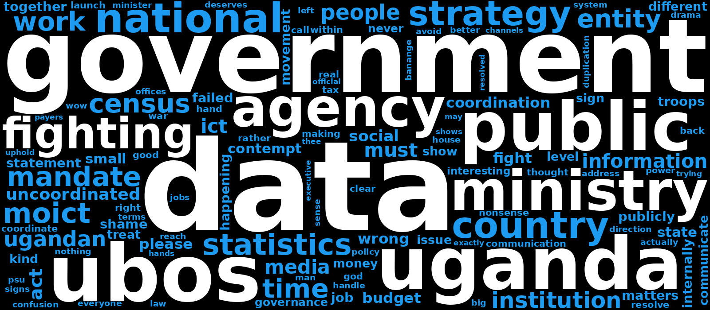

# UBOS on X

Sentiment analysis of how people on X responded to the Uganda Bureau of
Statistics (UBOS) when it rejected the Ministry of ICT's National Data Strategy.

- **Post:** [@StatisticsUg, 21 Oct 2026](https://x.com/StatisticsUg/status/2112882051552612637)
- **Dashboard:** [ubosonx.streamlit.app](https://ubosonx.streamlit.app)

## Key findings



- 515 responses analysed: 390 replies and 125 quote posts.
- 69% are negative, 28% neutral, and only 3% positive.
- 53% blame both bodies or government at large. 21% are against UBOS. 2% back UBOS.
- Top theme: coordination. Many ask why two government bodies are fighting in public.
- 64% of responses came in the first 4 hours.

## Dashboard

The dashboard has two pages:

- **General:** sentiment, stance, themes, timing, word cloud, and top posts.
- **Drill down:** filter by post type, sentiment, stance, theme, time, likes, or
  keyword. The charts, word cloud, and table follow your filters.

## Run it locally

1. Install Python 3.10 or later.
1. Install the packages:

   ```sh
   pip install -r requirements.txt
   ```

1. Start the app:

   ```sh
   streamlit run app.py
   ```

## Rebuild the dataset

`data/posts.csv` is built from the raw captures and the reviewed labels. To
rebuild it, run:

```sh
python scripts/build_dataset.py
```

## Project layout

| Path | What it holds |
| --- | --- |
| `app.py` | App entry point and page navigation. |
| `views/` | The General and Drill down pages. |
| `lib/data.py` | Data loading, colours, word cloud, and chart helpers. |
| `scripts/build_dataset.py` | Builds `data/posts.csv`. |
| `data/raw/` | Replies and quotes as captured from X. |
| `data/labels.txt` | Reviewed sentiment, stance, and theme for each post. |
| `docs/method.md` | How the data was collected and labelled. |

## Limitations

- X shows replies it ranks as relevant. Some replies may be hidden or deleted.
- Labels involve judgement. See [the method notes](docs/method.md).
- Display names with special fonts were simplified to plain text.

## Licence

Code: MIT. Post text belongs to its authors on X.
